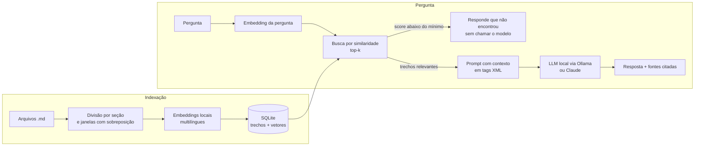

# RAG de projetos

Assistente que responde perguntas sobre a documentação dos meus projetos usando **RAG** (Retrieval-Augmented Generation). Ele busca os trechos mais relevantes nos documentos, envia só esses trechos para um modelo de linguagem e devolve a resposta **com a citação de cada fonte**.

**Roda 100% de graça e offline:** os embeddings e o modelo de linguagem rodam no seu computador, via [Ollama](https://ollama.com). Se quiser respostas de mais qualidade, dá para trocar para a API do Claude mudando uma variável.

A base de documentos de exemplo são os READMEs dos meus próprios repositórios (sistema de caixa, MatchMovie, Wayne Security System, Maison Rosé e MiniLang). Dá para perguntar, por exemplo, *"Como funciona o pagamento dividido no sistema de caixa?"* e receber a resposta apontando de qual seção ela saiu.

**Stack:** Python, FastAPI, SQLite, NumPy, sentence-transformers, Ollama (ou API do Claude), pytest, Docker e GitHub Actions.

## Como funciona



1. **Indexação** (`app/chunking.py`, `app/store.py`): cada Markdown é dividido por seção, guardando o caminho de títulos (ex.: `Sistema de Caixa > Atalhos de teclado`). Seções longas viram janelas de até 1.200 caracteres com 200 de sobreposição. Cada trecho vira um vetor e vai para o SQLite. A indexação é **incremental**: um hash SHA-256 de cada arquivo evita reprocessar o que não mudou, e documentos apagados saem do banco.
2. **Busca** (`app/rag.py`): a pergunta vira um vetor e o sistema pega os `k` trechos mais parecidos por similaridade de cosseno.
3. **Geração** (`app/prompts.py`, `app/llm.py`): os trechos vão para o modelo com instruções para usar só esse contexto, citar cada informação com `[n]` e admitir quando não souber.

## Decisões técnicas

- **Modelo de linguagem trocável.** A interface `LLM` tem duas implementações: `OllamaLLM`, padrão, que roda um modelo aberto localmente (`qwen2.5:3b`) sem custo, e `ClaudeLLM`, que usa a API da Anthropic. Basta mudar `LLM_PROVIDER`.
- **Embeddings locais.** O modelo `paraphrase-multilingual-MiniLM-L12-v2` roda na máquina, entende português e não tem custo por chamada. A interface `Embedder` permite trocar por um serviço de embeddings sem mexer no resto.
- **SQLite + NumPy como banco vetorial.** Para alguns milhares de trechos, calcular a similaridade em memória é rápido e não exige servidor. Os vetores ficam normalizados, então o cosseno é só um produto escalar. Para volumes maiores, o próximo passo é pgvector.
- **Limite mínimo de similaridade.** Se nenhum trecho passa de `MIN_SCORE`, a API responde que não encontrou a informação **sem chamar o modelo**. Isso economiza custo e evita resposta inventada.
- **Citações verificáveis.** As fontes devolvidas são só os trechos que o modelo realmente citou, com documento, seção e score.
- **Proteção contra prompt injection.** O contexto vai em tags XML separado da pergunta, e o prompt de sistema manda tratar os trechos como dados, ignorando qualquer instrução escondida neles.
- **Testável sem rede.** `HashEmbedder` e `FakeLLM` substituem os modelos nos testes, e as chamadas ao Ollama são testadas com um transporte HTTP simulado. A suíte roda em segundos e no CI.

## Como rodar

Requer Python 3.10+ e o [Ollama](https://ollama.com) instalado. Nenhuma chave de API é necessária.

```bash
ollama pull qwen2.5:3b      # baixa o modelo de linguagem (cerca de 2 GB, só na primeira vez)

git clone https://github.com/kawoliv/rag-projetos.git
cd rag-projetos
python -m venv .venv && source .venv/bin/activate   # no Windows: .venv\Scripts\activate
pip install -r requirements.txt

cp .env.example .env
python -m app.cli indexar   # na primeira vez, baixa o modelo de embeddings
uvicorn app.api:app --reload
```

Num computador sem placa de vídeo, cada resposta leva alguns segundos. Se ficar lento, troque para um modelo menor (`OLLAMA_MODEL=qwen2.5:1.5b`); se tiver uma máquina boa, um maior responde melhor. Para usar o Claude, defina `LLM_PROVIDER=claude` e `ANTHROPIC_API_KEY` no `.env`.

Abra `http://localhost:8000` para usar a página de demonstração, ou `http://localhost:8000/docs` para a documentação interativa da API.

Pelo terminal:

```bash
python -m app.cli perguntar "Quais abas tem a planilha gerada no fechamento do caixa?"
```

Para usar com os seus próprios documentos, coloque arquivos `.md` ou `.txt` em `docs/` (ou aponte `DOCS_DIR` para outra pasta) e rode `indexar` de novo.

## API

| Método | Rota | O que faz |
| --- | --- | --- |
| `POST` | `/perguntar` | Responde uma pergunta. Corpo: `{"pergunta": "...", "k": 4}` |
| `POST` | `/indexar` | Indexa a pasta de documentos (só o que mudou) |
| `GET` | `/documentos` | Lista os documentos indexados e quantos trechos cada um tem |
| `GET` | `/saude` | Status e total de trechos |

Formato da resposta de `/perguntar`:

```json
{
  "resposta": "Texto da resposta, com citações como [1] e [2].",
  "encontrou": true,
  "fontes": [
    {"n": 1, "documento": "sistema-de-caixa.md", "secao": "...", "trecho": "...", "score": 0.61}
  ]
}
```

Erros: `422` para pergunta inválida (vazia, curta ou longa demais) e `502` quando o modelo falha ou o Ollama não está rodando, com uma mensagem dizendo o que fazer.

## Testes e avaliação

```bash
pip install -r requirements-dev.txt
pytest -q
```

Os testes cobrem a divisão em trechos, o banco vetorial, a indexação incremental, a montagem do prompt, a filtragem de fontes citadas e as rotas da API. Eles rodam a cada push pelo GitHub Actions.

Para medir a qualidade da **busca** (sem gastar com o modelo), há um conjunto de perguntas com o documento esperado em `eval/perguntas.json`:

```bash
python -m app.avaliar -k 4
```

O script mostra, para cada pergunta, se o documento certo apareceu entre os `k` primeiros, e o acerto geral. Serve para comparar ajustes de tamanho de trecho, sobreposição, modelo de embeddings e `k`.

## Docker

O `docker-compose.yml` sobe o Ollama e a API juntos:

```bash
docker compose up -d --build
docker compose exec ollama ollama pull qwen2.5:3b   # só na primeira vez
```

O modelo de embeddings é baixado durante o build, e o container da API indexa os documentos ao subir.

## Configuração

| Variável | Padrão | Descrição |
| --- | --- | --- |
| `LLM_PROVIDER` | `ollama` | `ollama` (gratuito, local) ou `claude` (API paga) |
| `OLLAMA_URL` | `http://localhost:11434` | Endereço do Ollama |
| `OLLAMA_MODEL` | `qwen2.5:3b` | Modelo local usado nas respostas |
| `ANTHROPIC_API_KEY` | — | Só para `LLM_PROVIDER=claude` |
| `CLAUDE_MODEL` | `claude-haiku-4-5` | Modelo do Claude, se usado |
| `EMBEDDING_MODEL` | `paraphrase-multilingual-MiniLM-L12-v2` | Modelo de embeddings |
| `DOCS_DIR` | `docs` | Pasta com os documentos |
| `DB_PATH` | `data/rag.db` | Arquivo do SQLite |
| `TOP_K` | `4` | Trechos recuperados por pergunta |
| `MIN_SCORE` | `0.30` | Similaridade mínima para considerar um trecho relevante |

## Próximos passos

- Respostas em streaming na API e na página.
- Comparar a qualidade das respostas entre modelos locais e o Claude com o mesmo conjunto de perguntas.
- Reranking dos trechos recuperados antes de enviar ao modelo.
- Avaliação da resposta final, não só da busca: checar se cada citação realmente sustenta a frase.
- pgvector para bases maiores e suporte a PDF.

## Estrutura

```
app/
  api.py         rotas FastAPI
  rag.py         pipeline: indexação e perguntas
  chunking.py    divisão dos documentos em trechos
  embeddings.py  modelo local e embedder de teste
  store.py       SQLite e busca vetorial
  prompts.py     prompt de sistema e montagem do contexto
  llm.py         clientes do Ollama e do Claude, e modelo falso para testes
  cli.py         comandos indexar e perguntar
  avaliar.py     avaliação da busca
  static/        página de demonstração
docs/            documentos de exemplo
eval/            perguntas de avaliação
tests/           testes automatizados
```
